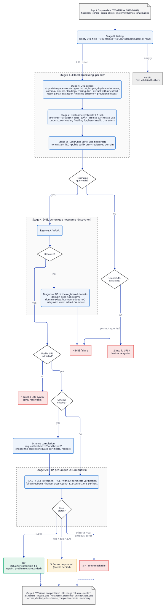

# mhlw-opendata-url-checker

Staged validation of the website URLs listed in Japan's medical facility open data
(Japan Medical Information Net / 医療情報ネット, Ministry of Health, Labour and Welfare).
The share of URLs that fail at each stage — URL syntax, hostname syntax, TLD, DNS, HTTP —
is used as a proxy for how well domain names and hostnames, the "addresses" of the
Internet, are understood by the people who register them.

This repository contains the code used in the paper cited below, so that reviewers and
readers can inspect and re-run the analysis.

| File | Role |
|---|---|
| [`check_urls.py`](check_urls.py) | Reads the open data CSVs, validates every listed URL in stages, writes result CSVs |
| [`plot_results.R`](plot_results.R) | Draws the figures (colour / monochrome × English / Japanese) from those CSVs |
| [`docs/pipeline.d2`](docs/pipeline.d2), [`docs/pipeline.svg`](docs/pipeline.svg) | Processing-flow diagram of `check_urls.py` ([D2](https://d2lang.com/) source and rendered SVG) |

> **日本語の概要**
> 医療情報ネット（厚生労働省）のオープンデータに掲載された病院・診療所・歯科診療所・助産所・薬局の
> ホームページアドレスを、URL構文 → ホスト名構文 → TLD → DNS → HTTP の順に段階的に検証し、
> どの段階で問題が生じたかを集計するコードです。`check_urls.py` が検証と集計を、
> `plot_results.R` が論文用の図（カラー／モノクロ、英語版／日本語版）を作成します。
> 出力CSVのカテゴリ名は日本語で、図の英語版では `plot_results.R` の `EN_MAP` で英訳しています。

---

## Contents

- [Requirements](#requirements)
- [Input data](#input-data)
- [Quick start](#quick-start)
- [Method](#method)
- [Output files](#output-files)
- [Figures](#figures)
- [Reproducibility notes](#reproducibility-notes)
- [Network etiquette](#network-etiquette)
- [Limitations](#limitations)
- [Citation](#citation)
- [License](#license)

---

## Requirements

### Python (`check_urls.py`)

- Python ≥ 3.10
- `requests` ≥ 2.32, `urlextract` ≥ 1.10, `dnspython` ≥ 2.6, `tldextract` ≥ 5.1

The dependencies are declared inline ([PEP 723](https://peps.python.org/pep-0723/)), so
[uv](https://docs.astral.sh/uv/) installs them automatically:

```sh
uv run check_urls.py --help
```

Without uv:

```sh
pip install "requests>=2.32" "urlextract>=1.10" "dnspython>=2.6" "tldextract>=5.1"
python check_urls.py --help
```

Network access (DNS and HTTP/HTTPS) is required.

### R (`plot_results.R`)

- R ≥ 4.1 (uses the native pipe `|>`); ggplot2 ≥ 3.5 is recommended (`legend.location`)
- Packages: `ggplot2 svglite ragg systemfonts readr dplyr tidyr scales forcats stringr`

```r
install.packages(c("ggplot2", "svglite", "ragg", "systemfonts", "readr",
                   "dplyr", "tidyr", "scales", "forcats", "stringr"))
```

- Fonts: **Verdana** (English text and all numbers) and **Meiryo** (Japanese text).
  Both ship with Windows. On other platforms install them or change `JP` / `NUM` in
  `render()`; the figures will otherwise fall back to a default font.

---

## Input data

The open data is **not** redistributed in this repository. Download the facility files of the
2026-06-01 release of the Japan Medical Information Net open data from the MHLW website and
place them in one folder (e.g. `data/`):

| File | Facility type | URL column | Name column |
|---|---|---|---|
| `01-1_hospital_facility_info_20260601.csv` | Hospitals (病院) | `案内用ホームページアドレス` | `正式名称` |
| `02-1_clinic_facility_info_20260601.csv` | Clinics (診療所) | `案内用ホームページアドレス` | `正式名称` |
| `03-1_dental_facility_info_20260601.csv` | Dental clinics (歯科診療所) | `案内用ホームページアドレス` | `正式名称` |
| `04_maternity_home_20260601.csv` | Maternity homes (助産所) | `案内用ホームページアドレス` | `正式名称` |
| `05_pharmacy_20260601.csv` | Pharmacies (薬局) | `薬局のホームページアドレス` | `名称` |

Every file must also have an `ID` column. Files are read as UTF-8 (a BOM is accepted).
To use another release, edit `FILES` in `check_urls.py` and `KINDS` in `plot_results.R`.

---

## Quick start

```sh
mkdir results
uv run check_urls.py --dir data --outdir results     # validation (takes a while: DNS + HTTP for every host)
Rscript plot_results.R results figs                  # figures
```

`--outdir` must already exist. For a quick test, `--limit 300` restricts DNS/HTTP to the
first 300 unique hostnames (rows on other hosts are then omitted from the output).

### `check_urls.py` options

| Option | Default | Meaning |
|---|---|---|
| `--dir` | `.` | Folder containing the input CSVs |
| `--outdir` | `.` | Folder for the output CSVs (must exist) |
| `--workers` | `32` | Number of parallel threads for DNS and HTTP |
| `--timeout` | `15` | HTTP read timeout in seconds (connect timeout = min(timeout, 5)) |
| `--per-host` | `2` | Maximum concurrent HTTP connections to one hostname |
| `--limit` | `0` | Maximum number of hostnames checked by DNS/HTTP (0 = all) |

### `plot_results.R` arguments

```sh
Rscript plot_results.R [in_dir] [out_dir] [notitle] [color|mono]
```

| Argument | Default | Meaning |
|---|---|---|
| `in_dir` | `results` | Folder with `all_results.csv` and `summary.csv` |
| `out_dir` | `figs` | Output root |
| `notitle` | – | Omit in-figure title, subtitle and caption (when captions go in the manuscript) |
| `color` / `mono` | both | Draw only the colour or only the monochrome (greyscale) edition |

---

## Method

Each row whose URL field is non-empty is validated in the stages below. Stage 0 uses all
rows; every later stage uses only rows with a URL. DNS is queried once per unique
hostname, HTTP once per unique URL.

### Processing flow

Each listed URL ends in exactly one overall verdict (the `stage` column; red, amber and green
boxes). The verdicts are explained in [Overall verdict](#overall-verdict-stage).

<p align="center">
  
</p>

The diagram is generated from [`docs/pipeline.d2`](docs/pipeline.d2) with
[D2](https://d2lang.com/) v0.8:

```sh
d2 --layout elk --pad 20 docs/pipeline.d2 docs/pipeline.svg
```

### Stage 0 — Listing

Share of facilities with and without a URL (denominator: all rows of the file).

### Stage 1 — URL syntax

1. Whitespace before/after or inside the value is removed and recorded.
2. **Mechanical repair** of common typos (each repair is recorded in `url_problems`):
   - misspelled scheme or separator: `http//`, `https:`, `htpp://`, `http.//`, `http::/`,
     `www.https://`, `http:s//`, … → `http://` or `https://`
     (`https` if the misspelled scheme ends in `s`, otherwise `http`);
   - duplicated scheme, e.g. `http://www.https://example.jp` → the latter is kept;
   - wrong separator after `www` (`http://www//example.jp`, `http://www:example.jp`);
   - in the hostname: comma instead of dot, consecutive dots, leading/trailing dot.
3. A URL is extracted with `urlextract`. Additional problems recorded: multiple URLs (the
   first is used), extra text around the URL, `//` in the path, non-HTTP scheme.
4. If the scheme is missing, `http://` is prepended **provisionally**; the correct scheme is
   decided at stage 5 (see *Scheme completion*).
5. If `urlextract` returns a hostname different from the one parsed directly from the text
   (partial extraction, e.g. `uedaｰshiso.jp` → `shiso.jp`), the extraction is rejected,
   because it would check a different host.

`scheme_state` is `あり` (present), `欠落` (missing) or `誤記修正` (misspelled, corrected).

### Stage 2 — Hostname syntax (RFC 1123)

IP literal, non-ASCII text without a dot (not a URL), full-width/kana characters,
empty labels, IDN conversion failure, internationalized domain name, hostname > 253 chars,
no dot, label > 63 chars, underscore, label starting/ending with a hyphen, other invalid
characters. Hostnames are converted to ASCII (IDNA) before checking.

### Stage 3 — TLD

The public suffix and registered domain are determined with `tldextract` (Public Suffix
List). A hostname whose last label is not a known suffix is flagged as *nonexistent TLD*;
a hostname that is only a public suffix is flagged as such.

### Stage 4 — DNS

Hosts that are syntactically queryable (≥ 2 non-empty labels, ≤ 253 chars) are resolved
with `dnspython` using the system resolver configuration (timeout 3 s, lifetime 6 s, no
retries beyond dnspython's own).

| `dns_status` | Meaning |
|---|---|
| `解決可` | Resolved (A or AAAA) |
| `ドメインが存在しない` | NXDOMAIN, and the registered domain is NXDOMAIN too (unregistered / expired / misspelled) |
| `ホスト名が存在しない` | NXDOMAIN for the hostname; see `domain_status` for the registered domain |
| `名前は存在するがアドレスなし` | Name exists but has no A/AAAA record |
| `DNS応答異常(…)` | SERVFAIL, TIMEOUT or other error |
| `未照会（…）` | Not queried (invalid hostname syntax / no hostname) |

For unresolved hosts, the **NS record of the registered domain** is queried to distinguish
"the domain does not exist" from "the domain exists but this hostname does not" (typo in
the host part, or the hosting service ended). Independently, the name with `www.` added
or removed is tried (`www_alt`). Resolved hosts whose addresses are all non-global
(private, loopback, …) are flagged in `dns_note`.

### Stage 5 — HTTP reachability

Only URLs whose host resolved are requested. For each URL:

1. `HEAD`, following redirects. A status < 400 is accepted.
2. Otherwise (status ≥ 400 or a connection error), `GET` with `stream=True`, following
   redirects; the body is not downloaded.
3. If TLS certificate verification fails, `GET` again **without** verification, to separate
   "only the certificate is wrong" from "unreachable". Such URLs are reported with
   `cert_ok = False`.

A final status < 400 is **reachable**. **401, 403 and 429** are reported separately as
*access denied*: the server responded, so the URL and hostname are correct, but it refused
the automated request. For these the WAF/CDN is guessed from response headers
(Cloudflare, Akamai, CloudFront/AWS WAF, Imperva, Sucuri, Fastly, SiteGuard). No attempt
is made to bypass such refusals. Any other status ≥ 400, timeout or connection error is
**unreachable**.

### Scheme completion (URLs listed without a scheme)

Both `http://` and `https://` are requested, and the correct scheme is decided as follows
("responds" = reachable or access denied):

| Condition | `scheme_correct` | `scheme_verdict` |
|---|---|---|
| HTTPS responds with a valid certificate, HTTP redirects to HTTPS | https | `https が正（http は https へ転送）` |
| HTTPS valid, HTTP also responds without redirect | https | `https が正（http でも到達可・転送なし）` |
| HTTPS valid, HTTP does not respond | https | `https が正（http では到達不可）` |
| HTTP responds, HTTPS responds only with an invalid certificate | http | `http が正（https は証明書不正）` |
| HTTP responds, HTTPS does not | http | `http が正（https では到達不可）` |
| Only HTTPS responds, with an invalid certificate | https | `https のみ到達可（証明書不正）` |
| Neither responds | – | `どちらも到達不可` |

The HTTP result of the chosen scheme is then used as the row's reachability result.
`http_completion_ok` records whether naive completion with `http://` would have been right.

### Overall verdict (`stage`)

Each row receives the stage at which validation stopped:

| `stage` | English (figures) | Condition |
|---|---|---|
| `OK` | OK | Reachable, no problem recorded |
| `OK（要修正あり）` | OK after correction | Reachable, but only after a repair, or with a URL/hostname problem recorded |
| `5' 到達可（自動アクセス拒否）` | Server responded (access denied) | 401 / 403 / 429 |
| `5 HTTPで到達不可` | HTTP unreachable | DNS resolved but no successful HTTP response |
| `4 DNSで不正` | DNS failure | Hostname did not resolve |
| `1 URL構文で不正（DNSは解決可）` | Invalid URL syntax (DNS resolvable) | No usable URL, but the guessed hostname resolves |
| `1-2 URL/ホスト名構文で不正` | Invalid URL/hostname syntax | No usable URL and the hostname is not queryable |

---

## Output files

All CSVs are UTF-8 with BOM (opens correctly in Excel). Category values are in Japanese;
the tables above and `EN_MAP` in `plot_results.R` give the English equivalents.

| File | Rows |
|---|---|
| `all_results.csv` | Every row with a listed URL, all stages |
| `invalid_urls.csv` | Rows with a stage-1 problem (with the repair or reason) |
| `hostname_problems.csv` | Rows with a stage 2–4 problem, or a non-global address |
| `unreachable_urls.csv` | DNS resolved but HTTP unreachable (access-denied rows excluded) |
| `access_denied_urls.csv` | 401 / 403 / 429, with the WAF/CDN guess |
| `scheme_completion.csv` | Rows listed without a scheme, with the http/https verdict |
| `hosts.csv` | DNS result per unique hostname |
| `summary.csv` | Counts and percentages per file and in total (`合計`) |

### Columns of the row-level CSVs

| Column | Description |
|---|---|
| `file`, `kind`, `id`, `name` | Source file, facility type, facility ID, facility name |
| `raw` | URL field exactly as published |
| `check_url` | URL used for the HTTP check after repair (empty if unrecoverable) |
| `stage` | Overall verdict (see above) |
| `url_problems` | Stage-1 problems and repairs, separated by ` / ` |
| `scheme_state` | `あり` present / `欠落` missing / `誤記修正` misspelled, corrected |
| `host` | Hostname (lower case; as written, before IDNA conversion) |
| `host_problems` | Stage 2–3 problems, separated by ` / ` |
| `suffix`, `registered_domain` | Public suffix and registered domain (PSL) |
| `dns_status` | Stage-4 verdict |
| `domain_status` | For unresolved hosts: whether the registered domain exists (NS query) |
| `www_alt` | Set if the name with `www.` added/removed resolves |
| `dns_detail` | Raw resolver status: `OK`, `NXDOMAIN`, `NOANSWER`, `SERVFAIL`, `TIMEOUT`, `ERROR(…)` |
| `a`, `aaaa`, `cname` | Addresses and CNAME target |
| `dns_note` | Set if all addresses are non-global |
| `scheme_http`, `scheme_https` | Result for each scheme (only when the scheme was missing) |
| `scheme_correct`, `scheme_verdict`, `http_completion_ok` | Scheme completion verdict |
| `reachable` | `True` if the final HTTP status was < 400 |
| `status`, `final_url` | Final HTTP status and URL after redirects |
| `http_error` | `HTTP nnn` or exception name and message |
| `cert_ok` | `False` if reachable only without certificate verification |
| `denied`, `waf` | 401/403/429 flag and WAF/CDN guess |

### Denominators in `summary.csv`

- `URL記載あり` / `URL記載なし` (listed / not listed) and their `率%(全行中)` columns use **all rows**.
- Every other `率%` column uses `判定行数`, the number of rows with a listed URL.
- `スキーム補完 httpsが正 率%(判定できた欠落URL中)` uses only scheme-less URLs whose
  scheme could be determined.

---

## Figures

`plot_results.R` writes PNG (600 dpi, `ragg`) and SVG (`svglite`), 16 cm wide, to
`figs/<color|mono>/<en|ja>/`:

| File | Content | Denominator |
|---|---|---|
| `NN_<type>_1_url_presence` | URL listed or not (donut) | All facilities |
| `NN_<type>_2_overall` | Overall verdict (`stage`) | Listed URLs |
| `NN_<type>_3_scheme` | Scheme present / missing / misspelled | Listed URLs |
| `NN_<type>_4_scheme_completion` | Correct scheme for URLs without one (only if any) | Scheme-less URLs |
| `NN_<type>_5_dns` | DNS failure reasons | Listed URLs |
| `NN_<type>_6_url_errors` | URL notation errors, top 12 (multiple per URL counted separately) | Listed URLs |
| `NN_<type>_7_hostname_errors` | Hostname and TLD errors | Listed URLs |
| `NN_<type>_8_http` | HTTP non-success responses, top 12 | URLs whose host resolved |
| `00_all_1_url_presence` | URL listed or not, by facility type (100 % stacked) | All facilities |
| `00_all_2_overall` | Overall verdict, by facility type (100 % stacked) | Listed URLs |

`NN_<type>` is `01_hospital`, `02_clinic`, `03_dental`, `04_maternity` or `05_pharmacy`.
Values and legends are always labelled directly, so the figures can be read without
relying on colour; the monochrome edition uses evenly spaced grey levels. If a Japanese
category has no English translation in `EN_MAP`, the script warns and leaves it untranslated.

---

## Reproducibility notes

DNS and HTTP results depend on **when and from where** the script is run: domains expire,
sites move, servers time out, and WAFs may treat clients differently by network. Re-running
the code will therefore not reproduce the published numbers exactly. To support
verification:

- The results reported in the paper were obtained on **YYYY-MM-DD** from a network in
  **[location / network type]** with Python **3.13**, requests **x.y**, urlextract **x.y**,
  dnspython **x.y**, tldextract **x.y**. *(fill in)*
- The aggregated results used in the paper are published as [`summary.csv`](summary.csv)
  (CC BY 4.0, see [License](#license)).
- `tldextract` downloads the current Public Suffix List on first use and caches it (falling
  back to its bundled snapshot when offline); the PSL version can therefore differ between runs.
- DNS uses the operating system's resolver configuration, so results can be affected by the
  configured resolver (e.g. filtering or caching resolvers).
- Stages 0–3 are deterministic for given input files and library versions.

---

## Network etiquette

- The client identifies itself honestly
  (`User-Agent: Mozilla/5.0 (compatible; url-reachability-check/1.0)`) and never impersonates
  a browser.
- At most `--per-host` (default 2) concurrent connections per hostname; no automatic retries.
- Only the top-level resource of each listed URL is requested (`HEAD`, then a streamed `GET`
  whose body is not read). No crawling.
- Access-denied responses (401/403/429) are recorded as such and never circumvented.

---

## Limitations

- A single vantage point and a single point in time; transient failures are counted as failures.
- Any HTTP status ≥ 400 other than 401/403/429 (including 404 and 5xx) is counted as unreachable,
  even though the server responded.
- Reachability is judged on the final URL after redirects; whether that page belongs to the
  facility (e.g. a parked domain or a domain taken over by a third party) is not assessed.
- When a field contains multiple URLs, only the first is checked.
- The typo repairs are heuristic; each one is recorded so that its effect can be audited
  (`url_problems`, and the distinction between `OK` and `OK（要修正あり）`).
- WAF/CDN identification is based on response headers only and is a guess.

---

## Citation

A paper describing this analysis is in preparation; its reference will be added here once
it is published. Until then, please cite the software (including `summary.csv`):

> Ma, T. (2026). *mhlw-opendata-url-checker* (Version 1.0.0) [Computer software].
> https://github.com/TanukiMa/mhlw-opendata-url-checker

Citation metadata is in [`CITATION.cff`](CITATION.cff); GitHub's **"Cite this repository"**
button generates APA and BibTeX from it. Each release is archived on Zenodo with a DOI.

Data source: Japan Medical Information Net open data (医療情報ネット オープンデータ),
Ministry of Health, Labour and Welfare, release 2026-06-01.

---

## License

- **Code** (`check_urls.py`, `plot_results.R`, `docs/`): [MIT License](LICENSE).
- **Data** ([`summary.csv`](summary.csv)): [Creative Commons Attribution 4.0 International
  (CC BY 4.0)](https://creativecommons.org/licenses/by/4.0/). When reusing it, please credit:

  > Tanuki Ma, *mhlw-opendata-url-checker* (`summary.csv`), https://github.com/TanukiMa/mhlw-opendata-url-checker, CC BY 4.0.
  > Derived from 医療情報ネット オープンデータ (Japan Medical Information Net open data),
  > Ministry of Health, Labour and Welfare, release 2026-06-01.

  `summary.csv` is UTF-8 with BOM and has Japanese column names; see
  [Denominators in `summary.csv`](#denominators-in-summarycsv) for their meaning.

The input open data itself is subject to the MHLW terms of use and is not included here.
